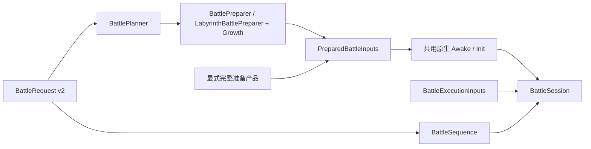

# 战斗场景输入与准备

Host 按“请求 → 规范化 → 数据准备 → 原生建场 → 会话运行”组织战斗。公开请求是 `BattleRequest`（`openpcr-battle/v2`），格式与字段来源见 [战斗请求与结果](../usage/battle-request.md)。计算器与原始养成数据在准备结束后释放。



## 数据与职责

| 数据／入口 | 内容 | 所在目录 |
| --- | --- | --- |
| `BattleRequest` | 公开请求：`Player`、`Settings`、`Battles`、一个玩法段；服务器形状的对象只声明模拟读取的字段 | `Host/Inputs` |
| `BattlePlanner` | 把请求规范化为每场的 `PlannedBattle`：`BattleDefinition`、强类型 `GrowthInputs`、开场 `BattleExecutionInputs`；推导场景并由布尔开关构造 Native 读取的值 | `Host/Inputs` |
| `BattleDefinition` | 来源无关的阵容、模式、场景、资源版本、账号消费子集、设置、日志；不含原始养成或操作 | `Host/Inputs` |
| `BattlePreparer` | 会战／训练场：从 `GrowthInputs` 生产每次独立的单位、Limited 刷新、队伍、账号及动态参数产品；返回前释放计算器 | `Host/Preparation` |
| `LabyrinthBattlePreparer` | 黎明界：同上，另生产 NPC、玩法与 EX 交接产品（`PreparedLabyrinthContext`） | `Host/Preparation` |
| `PreparedBattleInputs` | 场景定义与完整 `PreparedBattleProducts` 的会话交接边界 | `Host/Inputs` |
| `BattleSession` | 一场战斗的运行所有权、共用原生建场、步进、操作游标、检查点、UB 决策和结算读取 | `Host` |
| `BattleSequence` | 一份请求的整个战斗序列：逐场创建会话，EX 按上一队结算得出下一队状态；`ReadResult()` 返回 `BattleRunResult` | `Host` |
| `BattleRunner` | 一次运行到底：请求 → `BattleRunResult`，或显式准备产品 → `BattleResult` | `Host` |
| `BattleStageBinding`／`BattleSettingsBinding` 等 | 将类型化准备输入绑定到 Native 消费位置 | `Host/Runtime` |

共享参数产品及其使用时点由 `OpenPCR.BattleInputs` 管理，养成公式位于 `OpenPCR.Growth`。这套划分保持 Engine／Runtime 的类型布局和执行顺序。准备阶段需要只读资源和 masterdata，并且只能在没有活动战斗时执行；同一进程同时只运行一个战斗。

## 规范化

`BattlePlanner` 是请求到内部表示的唯一转换点：

- **场景**：会战按期次、阶段、周目和 BOSS 序号选地图行，推导敌人、时限、背景；黎明界由 `LabyrinthStage` 从关卡与难度推导。规则见 [战斗请求与结果](../usage/battle-request.md#clanbattle) 与 [黎明界模拟](../usage/labyrinth.md#由关卡推导的数据)。
- **账号**：己方 viewer ID 固定为 1，训练场支援 owner 为 2；`Releases` 的三个开放时刻写成当前时刻 2、开放 1／未开放 3，`KnightEnhance` 构造主线 2-6 的通关记录与到达关卡。Growth 与 Native 读取这些值的方式不变。
- **日志**：`ini_setting.battle_log_type` 给出账号开关，有效开关按 `BattleLog.GetLogEnable` 由值为 1 的类型得出。
- **设置**：`Settings` 与本场 `Opening` 合成 `BattleSettings`：AutoSpeed 按钮为 ON、开场 AUTO、`Speed > 1` 为加速、`Speed = 4` 为四倍速偏好；UB SET 模式恒为开启。
- **养成**：`unit_list` 与 NPC／支援的服务器对象按客户端 UnitData 的解析默认值转成 `RawUnit`／`RawSupportUnit`；计算结果字段不读取。

## 完整产品注入

调试时可绕过请求，直接 `new PreparedBattleInputs(definition, products)` → `BattleSession.Create(input, options, execution)`。调用方显式提供所有产品，运行路径不调用 Growth，缺产品时不退回计算器。

完整产品注入必须具备：

- 与显式阵容／敌人顺序和资源版本一致的单位；每个玩家分别有 Unique／Limited 及两份不可变参数输入，包含独立受伤 TP 的 HP／DEF／MDEF。
- 原始 ID＋support/replay flag 对应的 Limited 刷新产品，以及真实六星转换副本的刷新产品；缺失／重复／未知键失败。
- 双方队伍强化（每方可显式 null，非空须有三张完整字典）、稀有度门和已解析的 EX 装备身份。
- 完整动态参数产品，包括额外敌人和召唤规则。未知 owner／出生实参在原消费点明确失败；不得只按快照中后来出现的召唤清单反推。
- 场景环境、开场设置、日志配置、背景、seed、支援者归属等非养成输入。

注入产品时，须区分 `UnitParam`／`BonusParam`、运行单位 Total 和受伤 TP 基础值的计算时点。Native 对象图没有磁盘持久化协议。

准备产品包含可变的 Native 对象。`PreparedBattleInputs` 保存场景定义的独立副本；其产品集合在首次创建会话时转移所有权，之后调用方不得修改或复用这些对象。同一产品集合只能交给一个会话，即使重新包装为另一个输入也不能复用。重复运行应从场景定义重新准备，不能用通用 JSON 深拷贝改变原生的复制／共享关系。检查点是已有运行对象图的 Capture／Restore，与场景输入分开。

## 执行输入

`BattleExecutionInputs(Auto, ReserveUnitIds, Operations)` 是一场的开场 AUTO、SET 预约（原始单位 ID）和战斗中操作（转换后的战斗 ID）。请求路径从 `Battles[i]` 的 `Opening` 与 `Operations` 得出；直接用准备产品创建会话时由调用方提供，省略时为手动、无预约、无未来操作。运行中的 `ReplaceFutureOperations` 与 UB 决策探索见 [Worker 协议](../usage/worker.md)。

## 黎明界

`PreparedBattleInputs` 附带的 `PreparedLabyrinthContext` 包含关卡身份、完整角色参数、难度 actor 与执行时机、遗物效果组和强化／被动产品。类别 59 通过 `BattleSession.ReadLabyrinthSettlement()` 读取结算（`openpcr-labyrinth-settlement/v2`）。

类别 60 另附 `PreparedLabyrinthExContext`，每个会话运行一队，`ReadLabyrinthExSettlement()` 返回该队结算（`openpcr-labyrinth-ex-settlement/v2`）。结算完成须同时满足 Native 数据写入与相机门控的发送流程。`Enemies` 对应 `ExEnemyUnitList`，只在非最终队更新；最终敌方 HP／TP 取 `FinishRequest.Enemies`。读取续战产品前先检查 `IsFinalTeam`，最终队的 `EnemyContinuation` 保留原字段值。

`BattleSequence` 逐队运行 EX：同一时间只有一个活动的 `BattleSession`，当前队结束后释放，按 `LabyrinthExState.FromSettlement` 得出的下一队状态重新准备。首队状态由 `LabyrinthExState.Initial` 按 `initializeExEnemyList` 从关卡推导。`LabyrinthExState` 使用独立的 Host 输入记录读取原始标量，显式复制为 Native 容器；HP／MaxHP、伤害及 ViewerId 使用 Int64，己方 Energy 保持 double；敌人记录与关卡波次不一致时拒绝。

USER 单位引用 `Player.unit_list` 的原始养成；NPC 单位的服务器 `unit_data` 由计算器重建 UnitParam 和技能，`bonus_param` 保留原值或 null，不读取账号剧情。NPC 使用未限级的玩法产品，不执行会战等级／技能同步；null 的会战装备槽保持 null。原始账号与 NPC 使用同一 ID 时各自保留独立产品；USER 的玩法 UnitParameter 与账号字典共享同一对象。

`GrowthCalculator.PrepareLabyrinthMode(context)` 接收完整的持有角色条目、遗物有序列表、强化节点和显式 AlphaRupee 库存，返回独立的 `PreparedLabyrinthProducts`。主动技能仅选择 Enable 非零且含战斗技能的遗物；被动和印记计数保留 Native 的独立规则，不按 Enable 过滤。action 127 使用准备好的持有数量、职能／属性成员计数、库存和印记计数，运行时只执行乘法、限幅及目标动作的 AdditionalValue 写回。角色集合按声明条目计数，不代换成上场五人；缺失输入／未知查询明确失败。快照适配器要求库存字典存在；完整字典中没有库存 99012 时，按 Native SearchPossession 返回 0。

准备阶段可显式使用 `GrowthCalculator.CalculateLabyrinthEnemy(id)` 从 `labyrinth_enemy_parameter` 生产敌人产品，以及 `PrepareLabyrinthParameters(category, questId, difficulty)` 生产关卡额外效果、难度和隐藏遗物 actor 的参数模板。原 `CalculateEnemy` 继续只读普通敌人表；缺行明确失败。模板不包括遗物技能调度、难度执行时机或 EX 续战状态。EX 续战 HP 保留 Native 的 StartMaxHP／MaxHp 缩放、DoubleToLong 与存活最低 1 HP 规则，续战 TP 清零；最终请求则使用当前 TP，保留技能计数、伤害和已死亡敌人的顺序。`RuntimeMasterData.PrepareEnemyLookupMisses(ids, allowLabyrinth: true)` 可绑定明确启用的黎明界行转换；它保留普通表优先和全部 Native 前置表查询顺序，每次非空转换返回新对象，不改变普通战斗的默认范围。

黎明界多部件敌人的准备同时读取 `enemy_m_parts` 的子部件 ID，按目标敌人的真实索引行补齐有限查表结果；`PartsData` 仍在原生初始化位置读取子行、设置部件参数和天赋弱点。子 ID 不由父 ID 推算，不增加调用方输入，子行查表结果在建场前固定；未准备的查询仍明确失败。

## 宿主时钟与诊断重放

正常模拟使用 Host 的确定性 Update 时钟；相同场景、资源、seed、操作和宿主运行配置应产生相同结果。Update 频率影响帧末协程调度及终局事件的发生时点。

`BattleSession.Create` 的可选 `clock` 参数独立于战斗 FPS 和操作输入。省略时使用 `BattleUpdateClock.FixedRate(60)`；例如 `clock: BattleUpdateClock.FixedRate(30)` 显式指定每秒 30 次宿主 Update。它影响每次 Update 内的战斗 tick 数量以及帧末协程调度，不修改战斗帧号或日志。

诊断特定客户端运行时，可选用 `BattleUpdateClock.Timeline(initialFrame, initialTimeScale, updates)`，接收 Runtime 的完整 `EngineFrameTime` 序列，在构造时复制。每项包含有理数形式的 scaled/unscaled 时间与 delta，以及外部 FrameCount；初始值用于 Awake 之前，序列第一个元素用于本会话第一次 Update。允许零 delta 和变化的 delta，要求时间不倒退、FrameCount 递增、比例与数值有效。序列耗尽明确失败。仅在选择该诊断路径时，调用方才需提供与被诊断运行对应的时钟。

文件或跨进程输入使用 `BattleClockInput`（`openpcr-battle-clock/v1`），经 `Read`／`Parse` 校验后，由 `Prepare()` 生成不可变 Timeline。必填 `InitialFrame`、`InitialTimeScale` 和 `Updates`；每帧必填 `Time`、`DeltaTime`、`UnscaledTime`、`UnscaledDeltaTime` 与 `FrameCount`，每组有理数必填 int64 `Count` 和 uint32 `Numerator`／`Denominator`。仅接受完整的有理数时间字段；重复键、未知或缺失字段、null 和无效序列均拒绝。

CLI `run` 可用 `--clock <clock.json>`；Worker 的 `create` 使用可选 `clock` 对象。省略整个时钟参数保持默认 60 Hz，显式 null 被拒绝。`BattleRunner.Run` 与 `BattleSequence.Start` 也转交可选 `clock`；序列中每场使用同一时钟设置。时钟与场景、操作及准备产品分别交付；Worker 会在消费准备句柄之前完成时钟校验。错误或耗尽的时钟不生成完成结算，也不覆盖 CLI CSV 文件。三次 Update 的演示文件见 [three-updates.json](../../examples/clocks/three-updates.json)，它只用于短预算，不是完整战斗或设备时间轨迹。

检查点恢复后，会话按 Update 序号重新选择相同的时钟输入。时钟参数独立于 `BattleRunOptions` 和请求 JSON，仅在诊断重放时需要显式提供。

## 使用

日常创建／修改可使用独立 [BattleEditor CLI](../tools/battle-editor.md)：从明确预设创建、查询角色／敌人、修改养成／阵容／场景、预览并导出请求 JSON。工具复用校验与准备器，不包含战斗运行或操作编辑。手写示例见 [examples/battles](../../examples/battles/)。

```csharp
var request = BattleRequest.Read("examples/battles/trial.json");
var (input, execution) = BattlePreparer.Prepare(request, resources);
// 准备结束后，计算器和准备资源连接已释放。
using var session = BattleSession.Create(input, new BattleRunOptions(resources, 5000), execution);
session.Step(400);
using var checkpoint = session.Capture();
session.RunToEnd();
BattleResult result = session.ReadBattleResult();
ClanBattleSettlement settlement = session.ReadClanSettlement();
session.Restore(checkpoint);
```

`BattleRunner.Run(request, options)` 与 `BattleSequence.Start(request, options)` 从请求直接运行整个序列，准备仍发生在同一个交接边界。

## 验证

构建及无资源测试见 [构建与测试](../development/build-and-test.md)。请求 JSON 可先通过 BattleEditor inspect 查看，再用 validate 配合显式资源根检查并准备产品，最后交给 Runner 运行。校验和准备完成后，还需运行完整战斗验证实际场景；回归结果只覆盖已执行的输入与资源。
