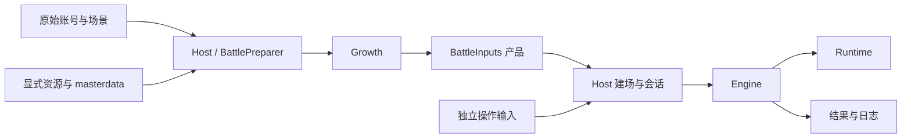

# 架构概览

OpenPCR 将输入转换、养成计算、资源装配和战斗运行分为独立阶段。同一进程同时只支持一个活动战斗会话；会话结束后释放战斗状态，并恢复会话开始前的 RNG 状态。

文档中，Native 指目标客户端的原生实现，Core 指 Engine 中的战斗核心；准备产品指准备阶段生成、交给战斗运行使用的数据对象。

| 模块 | 职责 |
| --- | --- |
| Engine | 战斗模型、初始化、动作、数值、生命周期与结算 |
| Runtime | 离线运行所需的时钟、RNG、对象身份和几何计算 |
| Platform | 编译所需的外部依赖声明和兼容边界；不支持的调用会报错 |
| Support | 通用数值约定、异常和准备边界辅助类型 |
| Growth | 使用原始养成数据和指定版本的 masterdata 计算准备数据 |
| BattleInputs | 保存准备阶段生成的数据，供战斗运行使用 |
| Host | 输入转换、准备流程、资源装配和战斗会话 |

Growth 计算器在准备阶段结束后释放。Engine 运行时读取准备产品、资源和实时状态；动态对象在原生执行点创建，保留原有的复制和引用共享关系。

场景协议与产品所有权见 [战斗输入](battle-inputs.md)，原始字段与计算产品见 [养成计算器](growth.md)，消费者细节见 [Core I/O](../reference/core-io.md)。省略显示、声音等表现功能时，仍需保留战斗逻辑依赖的数值顺序、RNG、时钟、暂停、对象池及协程行为。
