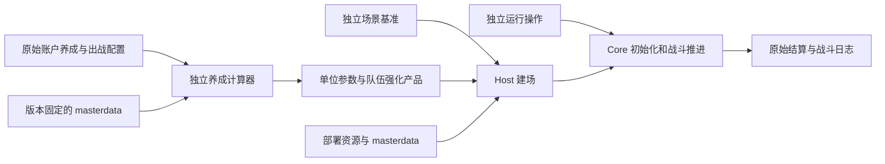

# Core 输入输出与养成交接

本文定义当前 C# 的单位参数、资源、运行环境和结果交接。请求格式见 [战斗请求与结果](../usage/battle-request.md)，内部分层见 [战斗输入](../architecture/battle-inputs.md)，计算器输入输出见 [养成计算器](../architecture/growth.md)。支持范围和验证要求见第 7 节。

场景定义由 `BattlePlanner` 从 `openpcr-battle/v2` 请求规范化得出；`BattlePreparer`／`LabyrinthBattlePreparer` 生产完整 `PreparedBattleInputs`。`BattleSession.Create` 接收显式完整准备产品，请求路径与注入路径进入同一个原生 `BattleManager.Awake`／`Init` → `coroutineStartProcess` → `UnitUiCtrl.Initialize`／`InitializeEnemyFirst` 建场流程。开场 AUTO、SET 与战斗中操作以 `BattleExecutionInputs` 单独交给会话。

分层、所有权和注入限制见 [战斗输入](../architecture/battle-inputs.md)。

请求路径从原始养成计算 Unique／Limited、独立受伤 TP 与队伍强化产品，并按玩法 ID 推导场景。Alter、六星转换与站位排序由 `UnitUiCtrl.Initialize` 执行，`UpdateLimitedUnitData` 读取准备产品；动态召唤与副敌在原 Native 消费点装配。计算器和原始养成输入在 Engine 初始化前释放。

## 1. 责任和数据流

这是 OpenPCR 的模块划分。计算器生成战斗前的参数产品；Host 装配阵容、敌人、模式、资源和开场环境，并接收运行操作；Core 负责初始化、被动、技能执行、状态、时钟、RNG、召唤生命周期和结算。提前生产的产品必须保留原生消费者所需的数据及使用时点。

支持类别 **9／32／59／60**，每场使用单个非空敌人波次；EX 通过多队序列续战。玩家暂停、战斗中变速和主动撤退不在操作协议中，黑屏、UB 暂停和技能行动速度由 Core 处理。

| 交接组 | 当前形状与消费者 | 负责生产／装配的部分 |
| --- | --- | --- |
| 单位参数 | `PreparedUnit`、`PreparedUnitInputs` → `UnitParameter` → `UnitCtrl.Initialize` | 养成计算器及参数装配 |
| 队伍强化 | `BattleStage.UnitTeamEnhanceInfo` / `EnemyTeamEnhanceInfo` → `UnitComponentPassiveSkill` | 养成准备阶段；双方分别提供 |
| 初始／动态敌人和召唤 | 初始 `UnitParameter` 列表、`PreparedParameters` 的 Enemy／Summon 提供器 | 场景及参数产品装配 |
| 场景与模式 | `BattleStage`、Clan／Trial／Labyrinth 上下文 → 原 processor | 调用方／场景装配 |
| 环境和操作 | 账号消费子集、`PreparedSettingsInputs`、操作时间线 | 账号／设置适配及调用方 |
| 静态数据和资源 | `RuntimeMasterData`、prefab／Spine／效果输入 | 部署资源提供器 |
| 帧与服务 | Host 固定步进、两个协程驱动、对象／资源实例及回调 | Host 会话运行设施 |
| 结果 | `BattleResult`、`BattleRunResult`、结算产品和日志 | Core 计算，Host 导出 |

## 2. 单位参数产品

现有实现：[PreparedUnit](../../src/OpenPCR.Host/Runtime/PreparedUnitAdapter.cs)、[PreparedUnitInputs](../../src/OpenPCR.Support/PreparedUnitInputs.cs)、[UnitParameter](../../src/OpenPCR.Engine/Elements/UnitParameter.cs)、[UnitCtrl](../../src/OpenPCR.Engine/Elements/UnitCtrl.cs)。

### 2.1 Unique 与 Limited

`PreparedUnit` 接受 `Unique`、`Limited` 两份 `UnitData`，各自绑定 `UniqueInputs`、`LimitedInputs`，并携带 `PrefabId`。`CreateParameter` 要求二者 ID 相同，按资源 ID 获取 `MasterData`／`SkillData`，再调用原始 `CreateCopyData`。绑定按**实际对象身份**保存，不按单位 ID 保存。

在当前 `UnitCtrl.Initialize` 中，公会战类别的可玩、非召唤／幻影、非 guest 单位读取 Limited 的 17 项属性；其它条件读取 Unique。等级、稀有度和许多技能／被动初始化仍读取 Unique。受伤回 TP 的三项独立基础值也从 **Unique 的绑定**读取，不能用 Limited 属性统一替代。

Growth 分别生产 Unique 与 Limited；Limited 应用等级封顶、技能同步和公会战 EX 槽规则，并准备转换身份的刷新产品。`IsClanSupportOrReplay` 控制这套生产机制，不能直接等同于“借用”。

Limited 必须在 Core 初始化前存在。getter 和原初始化入口仍可调用 `UpdateLimitedUnitData`，但输入边界只返回已准备的产品，缺失明确失败，不回调 Growth。

### 2.2 十七项战斗前总属性

顺序与 [eParamType](../../src/OpenPCR.Engine/Elements/eParamType.cs) 的 1..17 完全一致。数组长度必须为 17；HP 是 Int64，其余产品是 Int32。绑定使用 `long[]`，并检查后十六项的 Int32 范围。属性是**战斗被动应用前**的 `UnitData.Total*` 结果。

| 编号 | 参数 | 编号 | 参数 |
| --- | --- | --- | --- |
| 1 | HP | 10 | WAVE_HP_RECOVERY |
| 2 | ATK | 11 | WAVE_ENERGY_RECOVERY |
| 3 | DEF | 12 | PHYSICAL_PENETRATE |
| 4 | MAGIC_ATK | 13 | MAGIC_PENETRATE |
| 5 | MAGIC_DEF | 14 | ENERGY_RECOVERY_RATE |
| 6 | PHYSICAL_CRITICAL | 15 | HP_RECOVERY_RATE |
| 7 | MAGIC_CRITICAL | 16 | ENERGY_REDUCE_RATE |
| 8 | DODGE | 17 | ACCURACY |
| 9 | LIFE_STEAL | — | — |

`UnitComponentParameter` 的当前值、clamped 值、被动后的 MaxHp、暴击伤害倍率等运行字段不属于这 17 项产品。Core 按原始顺序初始化、应用 EX／free／main 被动、才能／骑士／定位强化，再产生战斗状态；这些运行状态不能作为战斗前属性输入。

### 2.3 独立受伤回 TP 基础值

产品另含 `DamagedEnergyHp`、`DamagedEnergyDef`、`DamagedEnergyMagicDef` 三个 Int64 值。[CalcUnitParameterForDamagedEnergy](../../src/OpenPCR.Engine/Elements/UnitUtility.cs) 从 Unique 绑定读取它们。

可玩单位走此读取路径；非可玩单位在初始化中使用所选 `UnitData` 的对应总属性。BOSS 自身 `SkillStackValDmg` 的特殊处理、virtual HP、玩家 Rank／TeamLevel 减免和站位系数继续在 Core 计算。计算器只提供独立基础值，不提供最终 TP 系数，也不能从某场的运行 HP／DEF／MDEF 倒推这些值。

### 2.4 参数配置和对象图

仅提供 17 项属性不足以运行技能、被动、召唤和结算。下表区分当前可见的消费与产品装配所需数据；不要求复制整个客户端 `UserData`。

| 数据 | 用途和交接要求 |
| --- | --- |
| `Id`、Original／转换关系、`UnitLevel`、`PromotionLevel`、`UnitRarity`、`BattleRarity` | 身份、等级、受伤 TP 减免、资源／技能变体、日志与结算。原始 ID、战斗转换 ID、资源 ID 分别保留；不统一重写为一个键 |
| `UnionBurst`、`MainSkill`、`ExSkill`、`FreeSkill` | 有序 `SkillLevelInfo(SkillId, SkillLevel, SlotNumber)` 列表。初始化与被动真实读取；保留槽位及零等级，不由正等级技能资源列表替代 |
| `UnitParam.BaseParam`、`UnitParam.EquipParam`、`BonusParam` | 养成分解产物。召唤准备的装备／剧情继承仍依赖它们；不能只保留 Total 数组。`ExceedStage` 与六星解放等原始条件由计算器用于生产产品 |
| `EquipSlot`、`UniqueEquipSlot` | 提供原始养成配置和专武槽选择依据；[GetUniqueEquipSlot](../../src/OpenPCR.Engine/Elements/UnitData.cs) 仍有真实技能变体消费者 |
| `ExEquipSlot`、`CbExEquipSlot` | 分别表达有效 EX 槽和公会战 EX 槽的准备来源。当前运行初始化读取所选 UnitData 的有效槽；Cb 槽转换属于 Limited 生产 |
| `SerialId` → 实际 `ExEquipmentId` 的解析 | 当前 [UnitCtrl](../../src/OpenPCR.Engine/Elements/UnitCtrl.cs) 优先查询真实库存 serial，再读 `ex_equipment_data.Skill1/Skill2` 注册 EX 技能。当前 Host 从 `PreparedAccountGrowth` 产品填充此库存子集；属性加成计算也需相应强化／副词条原始输入 |
| `ResistStatusId`、`ResistVariationId` | 异常抗性与变体选择；保留 masterdata 对应键 |
| `SkinData`、敌人颜色、`PrefabId` 及皮肤设置 | 资源选择与骨骼数值输入；SD／动作资源会影响战斗几何 |
| `MasterData`、`SkillData` | 同版 masterdata 的实际镜像行。由 Host 按 ID 装配，供攻击类型、移动／索敌、技能集合和动作模式读取；计算器不生成替代行 |

产品需区分合法空列表、合法 null、显式的 0 和数据缺失。保留 Native 允许的 null，并按具体字段的缺失规则校验输入。`Power`、经验、收藏等字段不能仅因属于 UnitData 就列入 Core 必需输入；是否实现完整战力输出可由独立计算器另行决定。

非空嵌套记录须显式提供计算所需字段：技能的 `SkillId`、`SkillLevel`、`SlotNumber`；普通／专武槽的 `Id`、`IsSlot`、`EnhancementLevel`；EX 槽的 `SerialId`、`ExEquipmentId`、`EnhancementPt`、`SubStatus`；EX 副词条的 `Status`、`Step`；六星解锁的 `Slot1`、`Slot2`、`Slot3`。缺失这些字段会失败，不以默认零代替。服务器 light 支援的技能只携带等级，先按支援规则展开，再校验完整单位记录。

[CreateCopyData](../../src/OpenPCR.Engine/Elements/UnitData.cs) 先执行 `MemberwiseClone`，再复制指定的 UB／Main／EX 技能及 EX 槽，保留其它共享关系并传递绑定。产品装配须保持这些对象关系，不能用全对象 JSON 往返或统一深拷贝代替。

### 2.5 队伍强化与才能编成

双方分别提供可空的 [TeamEnhanceParameter](../../src/OpenPCR.Engine/Elements.Data/TeamEnhanceParameter.cs)；非空时需完整准备三张表：

| 表 | 当前精确形状 | Core 消费 |
| --- | --- | --- |
| `talentLevelParameter` | `Dictionary<int talentId, int>` | 按单位 TalentIds 累加才能等级攻击加成 |
| `knightEnhanceBuffParameter` | `Dictionary<int talentId, Dictionary<eParamType, int>>` | 合并骑士强化，按原顺序应用 |
| `roleBuffParameter` | `Dictionary<int roleId, Dictionary<eRoleParamType, int>>` | Core 根据单位 AtkType 转为实际参数，再应用定位强化 |

这些表是养成输出，不应预先合入 17 项 Total，否则 Core 会重复应用。`UnitTalentFormationBonusDictionary` 是另一项：当前 [BattleManager.calcTalentFormationBonus](../../src/OpenPCR.Engine/Elements.Battle/BattleManager.cs) 在 `IsReleasedKnightEnhance` 门后统计实战阵容的 TalentIds，再由 processor 查询编成奖励。该字典由 Core 在运行时生成；准备阶段只提供开放条件、实际阵容和相关表。编成奖励保持为运行时结果，不作为预计算输入。

### 2.6 原始输入分类

下表区分原始字段、准备产品和场景配置。字段必选／可选及缺失规则见 [计算器输入契约](../architecture/growth.md)；客户端对象中的同名字段可能已经是派生产物，不能直接作为原始输入。

| 原始来源 | 用于生产／装配 | 需注意 |
| --- | --- | --- |
| 单位 ID、等级、稀有度、Rank、普通装备／专武槽及强化、ExceedStage、六星解放状态 | base／equip 分解、技能／转换、Total 与独立受伤 TP 产品 | Total、BaseParam／EquipParam、BonusParam、Power 不作为原始养成输入；独立受伤 TP 保持单独口径，不复用普通 Total 公式 |
| UB／Main／EX／Free 技能的 ID／等级／槽号 | Unique 技能配置、Limited 封顶／同步配置 | 保留零等级和原顺序；SP／RF 在 Core 初始化中选择 |
| 已读剧情记录 | BonusParam | 不从目标战斗的聚合 BonusParam 反推原始记录 |
| EX 库存实例、serial、装备 ID、强化／Rank／副词条、两类装备槽 | EX 属性及有效技能装配、Limited 的公会战槽来源 | 区分账号库存、有效槽与限制条件；Native 属性计算和运行 EX 注册是不同消费阶段 |
| TeamLevel、技能同步／稀有度切换／骑士解锁的原始门条件、固定的准备时点 | Limited、受伤 TP 减免、资源与结算稀有度、队伍强化门 | 业务借用标签不能替代 Native flag；固定开场 FPS 与账号时点不能用墙钟或 frame0 运行状态补齐 |
| PrincessKnightInfo、UnitRoleInfo 等原始成长投入 | 队伍强化三张表 | 队伍强化从原始成长投入计算；实战编成奖励由 Core 另算 |
| 显式阵容、战斗稀有度／皮肤选择、支持者账号／所有者与场景 | 出战产品选择、归属、资源、敌人／召唤准备 | 属于本场配置／装配，并非角色成长字段；Seed、时间限制和玩家操作也不属于养成 |
| 同期 masterdata 与部署身份 | 所有公式、身份映射和资源装配 | 计算器读取范围见 GrowthMasterData；第 5 节的 Core 装载集合不是完整养成表清单 |

## 3. 敌人、额外敌人和召唤产品

现有实现：[PreparedParameterProducts](../../src/OpenPCR.BattleInputs/PreparedParameterProducts.cs)、[PreparedParameters](../../src/OpenPCR.Support/PreparedParameters.cs)。

| 产品 | 当前键与行为 | 边界要求 |
| --- | --- | --- |
| 初始敌人 | 显式单波、保持顺序的 UnitParameter 列表 | 不从运行中的敌人 HP、坐标或动作状态构造。类别 9 的 BOSS HP 会另经 processor 覆写 |
| 初始额外敌人 | 处理器在 `loadEnemy` 时由 `extra_effect_data` 选出 EnemyIds，经 `CreateUnitParameterFromEnemyParameter` 取产品；产品表预先准备以本场敌人为 `target_value_1` 的全部行 | 属于当前支持的额外效果；生成和注册时机由 Core 处理 |
| 动态敌人参数 | `Enemy(enemyParameterId)` | 必须提供每次调用的新产品，ID 与 masterdata 一致；缺失明确失败 |
| 召唤参数 | `Summon(owner, id, level, considerEquipment, mainSkill1Evolved)` | owner 是实际 UnitParameter 身份；其它四个参数全部参与键，不按 summon ID 或 unit ID 单独缓存 |

召唤产品在原消费点按实际 owner 引用身份与完整 tuple 装配。每次返回重新构造的可变参数／技能对象；`considerEquipment=true` 时按原机制将 owner **Unique** 的 `BonusParam`／`EquipParam` 引用赋给产品的 Unique 和 Limited。数值 Total 来自准备规则对该 owner 配置及 tuple 的计算。

## 4. 场景、环境、设置和玩家操作

现有装配：[BattleStageBinding](../../src/OpenPCR.Host/Runtime/BattleStageBinding.cs)、[BattleEnvironmentInputs](../../src/OpenPCR.Host/Runtime/BattleEnvironmentInputs.cs)、[ClanBattleBinding](../../src/OpenPCR.Host/Runtime/ClanBattleBinding.cs)、[BattleSettingsBinding](../../src/OpenPCR.Host/Runtime/BattleSettingsBinding.cs)、[BattlePlayerInputs](../../src/OpenPCR.Host/Runtime/BattlePlayerInputs.cs)。

| 组 | 需明确的数据 | 当前消费／限制 |
| --- | --- | --- |
| 阵容 | 每方 slot、参数产品身份、单位／prefab 键、敌人顺序、支持者与所有者 | Core 列表与资源、技能键必须一致。`Battles[i].Party` 显式给出五槽阵容，0 为空位、1 为训练场支援格；不选账号默认队伍 |
| 场景 | 类别 9／32／59／60、BattleTimeLimit（Single 秒）、Seed（Int32）、单波敌人 | 时限、敌人、背景由玩法 ID 推导；Seed 是一场战斗的场景输入，初始化前消费，不能注入 frame0 后的 RNG 状态作为普通开战输入。BattleLogId 只进入结算请求，内部为 0 |
| 类别 9 | BattleId、LapNum、Phase、BossOrderNum、BOSS MaxHp／CurrentHp、四倍速许可 | 效果难度、初始敌人 HP。演习 CurrentHp=0 有原生满血分支，请求的 `boss_hp` 要求 CurrentHp 为正。ClanId、TrainingId、ActualBossStatus、StockIndex 只进入结算请求，内部为 0 |
| 类别 32 | ClanBattleId、OrderNum、Phase、无限 HP 选择 | processor、BOSS 效果难度、伤害统计和结算 |
| 账号消费子集 | TeamLevel、ViewerId（Int64）、EnergyRecoveryRateMax（`errm`）、EX serial 解析、必要解锁条件 | TeamLevel 在 Core 的受伤 TP 减免中仍消费，不会因 Limited 已准备而全部删除。ViewerId 只作归属键，请求路径固定为 1（支援 owner 2） |
| 解锁／日志环境 | 骑士解锁条件、稀有度切换门、技能同步门；日志启用表、slip damage log barrier 门和 coefficient／threshold | 请求以 `Releases` 布尔给出，`BattlePlanner` 构造固定时点（当前 2、开放 1／未开放 3）与主线 2-6 通关记录，见 [推导开关](../usage/battle-request.md#推导开关) |
| 开场设置 | 有效 FPS 30／60、ApplyOtherUserSkins、UseUbSetMode、ResetSkillReserveEveryTime、AutoMode、逐单位 reserve；可选 SpeedQuadruple（缺省 false） | 固定逻辑步长 1/60；Native 按 AutoSpeed 和四倍速偏好恢复速度，资源派发返回匹配的有效 FPS。默认 Update 时钟的 scaled／unscaled delta 均为 1/60，不随 timeScale 改变。talent confirm=1、mute=true、cut-in=NONE |
| 多目标登场动画 | `Settings.PlayMultiTargetAppearance`：bool，缺省 false | 播放时保留 Engine 的暂停、计时、恢复及额外效果等待；Host 不持久化“一天一次”的客户端播放记录 |
| 其它现有设置 | AdvantageAndBreakdownBonusShows、MultiTargetFirst、TalentFormationBonusFirst、无限 HP 设置 | 当前 SaveData 提供器明确装配；MultiTargetFirst 不参与 Host 播放选择；无需复制完整 SaveDataManager |
| 外部操作 | auto_mode、ub_set_mode、manual_ub；目标玩家单位及有序操作 | 会战／训练场支持倒计时折算的 BattleClock 与 BattleFrame 锚点；同锚点保持输入顺序，只应用一次。黎明界不接受战斗中操作。锚点语义见 [Worker 协议](../usage/worker.md#运行操作和检查点) |
| 执行限制 | MaxEngineFrames、进度与日志观察器 | Host 运行预算／观察策略；不是 BattleTimeLimit，也不是养成条件 |

快照只记录多目标播放偏好时，当前适配层将 `MultiTargetConfirm=0`（每次）和 `1`（不播放）转换为明确的播放／不播放；`2`（一天一次）会被拒绝，不根据首次标记或本地日期推断本场选择。自定义场景直接使用 `PlayMultiTargetAppearance`。

玩家 HP／TP 由初始化与被动流程产生，请求不接受任意 `initialHp`／`initialEnergy` 覆写。满血取被动后的最大 HP，不能用被动前 TotalHp 代替。黎明界 EX 续战使用 [LabyrinthExState](../usage/labyrinth.md#ex-挑战) 交接。

会战（`kind: clan`）不接受支援（未接支援者生产链）。训练场的选中支援由 Growth 按服务器下发的 `unit_data` 生产登录态 Unique／Limited，作为训练场支援列表条目交给原 `UnitUiCtrl.Initialize`；不能用本地同 ID 单位代替。

## 5. masterdata、资源和运行设施

Core 在运行中仍读取 masterdata（`skill_action`、抗性、TP 衰减、才能奖励等），与养成计算器使用同一版本的库。

[RuntimeMasterData.LoadBattleTables](../../src/OpenPCR.Host/RuntimeMasterData.cs) 装载以下表；养成与场景推导还需各自的查询表：

| 用途 | 当前表 |
| --- | --- |
| 单位、技能、动作 | `unit_data`、`unit_skill_data`、`unit_skill_data_rf`、`unit_attack_pattern`、`skill_data`、`skill_action`、`spskill_lv_initialize_data`、`enemy_ignore_skill_rf` |
| 敌人、部件和抗性 | `unit_enemy_data`、`enemy_parameter`、`enemy_m_parts`、`resist_data`、`ailment_data`、`resist_variation_data` |
| TP／吸血／位置 | `tp_recovery_at`、`hp_drain_at`、`except_er`、`e_reduction`、`position_setting`、`unit_pos_adjustment`、`dodge_tp_recovery` |
| 才能、定位和场景 | `talent`、`unit_talent`、`unit_role_data`、`talent_weakness`、`enemy_talent_weakness`、`talent_formation_bonus`、`talent_formation_overwrite`、`extra_effect_data`、`clan_battle_2_map_data` |
| EX、声音与兼容读取 | `ex_equipment_data`、`sp_battle_voice`、`enemy_enable_voice`、`content_release_data`、`labyrinth_setting`、`labyrinth_skill_action_replace`、`unit_conversion` |

敌人查表保留 Native 的模式表查询顺序。黎明界行通过显式启用的转换生产者提供；其它模式表命中而未提供转换时失败。

| 资源／设施 | 必须保持的内容 | 现有位置 |
| --- | --- | --- |
| 部署身份 | 显式资源根；`masterdata/<version>_unhashed.db`、`prefab/unit_prefab_native.sqlite3`；只读、缺失失败 | [ResourceDatabases](../../src/OpenPCR.Host/ResourceDatabases.cs) |
| 单位与技能 prefab | geometry、部件／attachment、技能及 override 有序槽、exec time／damage weight、黑屏／慢速／镜头缩放／目标缩放／曲线、特效和投射物配置 | [UnitPrefabBindings](../../src/OpenPCR.Host/UnitPrefabBindings.cs)、[unit_prefab.proto](../../src/OpenPCR.Host/Schema/unit_prefab.proto) |
| 骨骼和动画 | SD／模式变换资源、骨骼／slot／attachment、动画时点／mix／完成、数值碰撞几何；SD 骨骼支持 prefab 皮肤替换，角色、动作类型和战斗动画保留原单位身份；战斗读取不可达骨骼及非路径约束目标 slot 附件的 timeline 只保留身份 | [AnimKitInputs](../../src/OpenPCR.Host/AnimKitInputs.cs)、[SkeletalColliderProducer](../../src/OpenPCR.Host/SkeletalColliderProducer.cs) |
| 动作效果／场地／EX 资源 | component 类型、粒子 lifetime、弹道／目标骨骼、缩放／定时、真实资源键、EX Scriptable 和动作依赖 | [SkillEffectResources](../../src/OpenPCR.Host/SkillEffectResources.cs)、[CommonEffectInputs](../../src/OpenPCR.Host/CommonEffectInputs.cs)、Runner 资源派发 |
| 实例和异步边界 | 新可变实例、组件／父节点身份、请求及完成回调顺序、对象池、销毁、激活 | `PreparedResourceInputBinding`、`PreparedBattleResourceLoads`、Host 建场 |
| 时钟和 RNG | Host 提供确定的 Update 时钟（默认固定 60 Hz），正常模拟不要求设备时钟输入；战斗 tick 保留 Native 累加推进；独立 openpcr-battle-clock/v1 仅为可选诊断重放；初始化前设 Seed；Unity RNG 状态及 HeldRandom 的保存／恢复语义 | [BattleUpdateClock](../../src/OpenPCR.Host/Inputs/BattleUpdateClock.cs)、[BattleClockInput](../../src/OpenPCR.Host/Inputs/BattleClockInput.cs)、[ScriptingRandom](../../src/OpenPCR.Runtime/Impl/ScriptingRandom.cs) |
| 离线完成输入 | Princess 分段播放的已有 decoder 策略、TIME_UP 在数值结算完成后的显示完成回调 | `PreparedPrincessMoviePlayback`、`PreparedTerminalDialog` |

资源提供器传递资源文件中的原始数据，并衔接生命周期；计算器不提供每帧坐标、动作时钟、动画结果或碰撞结果。当前 C# 仍在 `UnitCtrl`／`UnitActionController.Initialize` 计算技能等级、SP 固定等级、RF override 选择和实际动作展开；准备阶段不替换这些消费者，也不接受外部已展开的技能／RF 产品。纯图像／材质／音频输出继续使用现有表现边界，其外围定时、回调或共享 RNG 不能一并丢弃。

同一进程同时只允许一个活动战斗会话；结束后释放单例、准备绑定、协程、场景和静态战斗引用，并恢复外部 Unity RNG。部署数据在运行时使用，构建不需要这些数据。

## 6. 输出契约

通用输出类型见 [BattleResult](../../src/OpenPCR.Host/Inputs/BattleResult.cs) 与 [BattleSequence](../../src/OpenPCR.Host/BattleSequence.cs) 的 `BattleRunResult`；原始 finish 见 [PreparedBattleResultOutput](../../src/OpenPCR.Support/PreparedBattleResultOutput.cs)。序列结果的 JSON 形状见 [战斗请求与结果](../usage/battle-request.md#结果)。

`BattleSession.ReadTerminalTrace()` 单独返回 `openpcr-battle-terminal/v1`，记录原请求生产、发送门控和 EX 产品写入结束时的帧号、波次、状态、结果及毫秒余时。它与 `BattleResult` 分开：后者的 BattleFrame 是读取时的原计数；同一次 Update 可执行多个 tick，终局生产事件可能发生在该 Update 返回之前。观察终局时须区分事件帧与 Update 返回后的帧。读取轨迹不推进模型，缺少事件时返回当前已发生的序列，不从日志或最终帧重建。轨迹随会话检查点恢复；原结果 schema 保持不变。

| 输出 | 当前精确语义 | 约束与限制 |
| --- | --- | --- |
| `Completed`、`Result` | `Completed` 取决于原类别终止协议已完成；EX 同时等待单队数据写入与发送流程，不以 WIN／LOSE／TIME_OVER 字样单独判定 | 达到 MaxEngineFrames 但无 finish 时保留未完成，不生成成功结算；CLI `run` 返回 3 |
| `EngineFrame`、`BattleFrame`、`TimeRemaining` | Host 步进次数、Core FrameCount、剩余时间（Single 秒） | 分开保留，内部暂停可能使其不同；不以某一项推算另一项 |
| `BattleUnitResult[]` | UnitId、Enemy、Hp、MaxHp、Energy；读取首次启用 Update 时已建场单位的终态 | 不包含之后出生的召唤单位 |
| 结算 HP／伤害列表 | 原始 finish 的 `unit_hp_list` / `unit_damage_list`；HP 用 OriginalUnitId，HP 列表排除召唤／幻影，ViewerId 与伤害归属按原构造路径保留 | 不从诊断列表重建结算，也不合并转换 ID／所有者不同的记录；稀有度和原始顺序保留 |
| `ReadClanSettlement()` | `ClanBattleSettlement`：ClanBattleId、Phase、OrderNum、TotalDamage、HP 列表、伤害列表 | 由原 `TrialFinish` 或 `ClanFinish` 读取；类别 32 含无限 HP 与普通 HP 两种伤害统计口径。BOSS 余量 HP 与剩余时间见 `BattleResult` 的 `Units`、`TimeRemaining`；没有已完成结算时明确失败 |
| `ReadLabyrinthSettlement()` | `openpcr-labyrinth-settlement/v2`：QuestId、RemainTime（毫秒）、AutoClear、原始有序 HP／ViewerId 列表 | 类别 59；没有已完成结算时明确失败，不发送请求或执行响应回调 |
| `ReadLabyrinthExSettlement()` | `openpcr-labyrinth-ex-settlement/v2`：PartyIndex、IsFinalTeam、可空 FinishRequest（QuestId、Waves、Enemies、AutoClear）、Enemies、AlreadyDeadEnemies、Waves、UnitResults、ClearTypes、EnemyContinuation | 类别 60 单队的结算。非最终队没有 FinishRequest，`LabyrinthExState.FromSettlement` 由它得出下一队的起始状态。续战 TP 为 0，最终请求 TP 保留当前值；未完成时明确失败 |
| `BattleSequence.ReadResult()` | `openpcr-battle-result/v2`：Completed、Battles（Index、Battle、Settlement、Next）、Outcome | 整个序列。EX 的 Outcome 是最后一队后唯一一次 `boss_battle_finish` 的内容；某场耗尽帧预算时 Completed 为 false，该场 Settlement 为 null |
| `FrameRate`、`SystemId` | 建场时写入 BattleManager 的本场帧率，以及当前处理器的 `GetSystemId()`（会战 107、训练场 909、黎明界 136） | 客户端随 BattleLog 上传的两个值；是否上传由调用方决定 |
| `Csv` | 原始 BattleLog，受有效日志开关控制 | 日志生成与记录是 Core 输出；上传／网络不进入本边界 |
| `RandomState` | 读取结果时 Unity scripting RNG 的四个 UInt32 字；原 Core 完成流程可能已经恢复其开场保存状态 | 用作复现／验证信息；不是新一场默认开场输入。逐日志 RNG 指纹属于额外验证观察器 |
| `ScriptExceptions` | 可空的脚本异常诊断数组：EngineFrame、BattleFrame、TimeRemaining、Callback、ExceptionType、Message、StackTrace；无异常时 JSON 省略此字段 | 按发生顺序逐次记录，同局重复异常分别保留；StackTrace 截至脚本调用边界，不包含外层 Runner／Step／搜索调用者；结果是分离副本，检查点恢复会还原诊断前缀 |
| progress／battleLogRows | 定期进度通知、原始日志集合观察 | 观察器不能改变执行顺序或 RNG |

`PreparedBattleResultOutput` 内部的 `Units`、`Timeline` 是镜像对象，不是稳定序列化 schema，不进入公开结果。离线边界在请求产品完成处结束，不发送 API，不模拟响应，也不调用响应后账号写回／结果演出。

Host 在单次 `BattleManager.Update` 调用外隔离可定位到 Engine 游戏脚本的异常，记录后继续独立协程和帧末阶段，下一次 Update 照常执行。异常中断该次回调的剩余语句；已写状态、RNG 和协程列表保持原状，不回滚、不补跑、不在游戏内部逐协程捕获。未实现／范围外入口、部署或绑定错误、Host／Runtime／输入适配器错误和 UB 搜索控制信号仍向外抛出并遵循原故障处理。异常出处无法确定时也向外抛出。

养成计算器的输出是参数、队伍强化等准备产品，与战斗结算分开。

## 7. 当前支持范围

`BattleRequest`（`openpcr-battle/v2`）是独立的输入协议，由己方原始养成、设备设置、战斗列表和玩法段组成；资源目录与运行帧预算单独由 `BattleRunOptions` 提供。`BattleSession` 继续提供未来操作替换、步进、检查点和 UB 决策接口。

请求只接受约定的原始输入和玩法字段。完整产品调试入口接收类型化 `PreparedBattleProducts`；缺失 Unique／Limited、转换刷新、队伍／账号或动态规则时失败。

| 限制 | 当前处理 |
| --- | --- |
| 会战支援 | 缺少原始支援生产链，明确拒绝；训练场已支持服务器 payload |
| 任意玩家初始 HP／TP、任意敌方属性 | 不在当前构造协议中；玩家走原初始化，敌人来自同版 masterdata，类别 9 可定义 Boss 场景 HP |
| 多波次、竞技场、战斗中暂停／变速／撤退 | 未开放；黎明界 EX 的多队由 `BattleSequence` 逐队新建会话运行 |
| 输出格式 | 公开结果使用 `openpcr-battle-result/v2`；内部镜像对象不提供序列化契约，`Units` 不记录完整实例生命周期 |

验证分为原始输入解析、养成产品逐项对照、产品到 Core 的交接、独立场景、原始结算和标准回放。重点覆盖 Unique 与 Limited 的差异、转换与同步、EX、支援归属、召唤继承、队伍强化，以及有限和无限 HP 的不同逻辑。报告结果时注明实际输入、资源和覆盖的场景。
